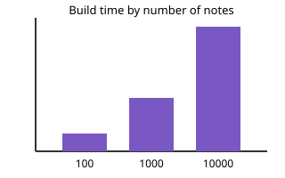

#+title: Gallery

Figures and a formula for the Lantern report.

* Figures

The photograph for the cover:

The chart for the results:

* The formula

The build time grows linearly: $t(n) = a + b\,n$, with $b \approx 1.2$ ms per note.
