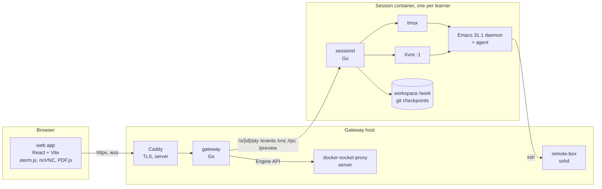

# Emacs Playground — design overview

A hands-on Emacs course in the browser on a real, fully configured Emacs in a container. Learners do real work in Rust, OCaml, Python, Markdown, Typst and LaTeX; every keystroke is explained, there is always a way out of a confusing state, and any step can be reset.

Slice 1 is implemented (§10). The code is authoritative where a document disagrees; commands and ownership are in AGENTS.md.

## 1. Reading guide

| Document | Covers |
|---|---|
| [architecture.md](architecture.md) | data ownership, flows, state machines, failures, budgets |
| [deployment.md](deployment.md) | images, Compose, configuration, security |
| [backend.md](backend.md) | gateway, sessiond, playctl, step engine, checkpoints |
| [api.md](api.md) | HTTP, WebSocket, RPC and agent protocol |
| [emacs.md](emacs.md) | session image, modules, frames, agent |
| [frontend.md](frontend.md) | screens, panes, advice engine |
| [CURRICULUM.md](CURRICULUM.md) | the course and its authoring format |
| [third-party.md](third-party.md) | dependencies |
| [notes.md](notes.md) | workflow, test tools, known limitations, authoring pitfalls |

The design demo (`../design/demo/index.html`) fixes the shapes of events and advice.

## 2. Goals

- Learn by doing: each part ends in a project mirroring a VS Code workflow.
- Live feedback: a ticker names each chord and its command; "Where am I" reads Emacs state and shows one exit.
- Progressive configuration: near vanilla in Part 0, modules unlock as taught, a complete config at the end.
- Safe retry: Rescue fixes UI state without touching files; Reset restores the step's checkpoint.
- One set of images for local single-learner and multi-learner server use.
- The daily VS Code workflow first, then what only Emacs does well (Org, text as interface, composable packages).

Non-goals for v1: collaboration, an evil-mode track, billing, phone layouts.

## 3. Principles

1. Read state, never guess intent (architecture.md §4).
2. Emacs is the hero: browser chrome never covers the Emacs pane.
3. Built-in first; alternatives are taught, not imposed.
4. One source of truth per fact: Go defines protocol and config schema (TypeScript and JSON Schema are generated); the curriculum defines lessons, sessiond evaluates them.
5. Everything resettable: disposable containers, a git workspace, an Emacs that restarts with its buffers.
6. Small, boring dependencies.

## 4. System at a glance



| Component | Responsibility | Detail |
|---|---|---|
| web | screens, panes, ticker, Where am I, nudges, preview | frontend.md |
| gateway | auth, sessions, routing, curriculum, progress | backend.md §2 |
| sessiond (per session) | supervises Emacs, tmux, Xvnc; endpoints; input tap; step engine; checkpoints | backend.md §3 |
| playground-agent.el | state and command reports; rescue, check, reset, snapshot | emacs.md §10 |
| playctl | curriculum validate, build, replay; config check; TypeScript types | backend.md §4 |
| curriculum | lessons, fixtures, exit and habit tables | CURRICULUM.md |

## 5. Deployment modes

- Local: gateway with the static backend (no auth, one session), one session container with `./workspace` bind-mounted, the remote box.
- Server: adds Caddy and a Docker socket proxy; the docker backend authenticates learners and runs one hardened container per learner on its own network and volume, stopping idle ones (deployment.md).

## 6. The flows that matter

Specified in architecture.md §3.

## 7. Technology choices

Go 1.27 with the stdlib mux, `coder/websocket`, `creack/pty`, the Docker client, fsnotify and `modernc.org/sqlite`; React 19, Vite, TypeScript, Zustand, TanStack Query, React Router, CSS Modules; xterm.js 6.1 beta, noVNC, PDF.js; Emacs 31.1 from source (Lucid, native compilation, tree-sitter) with vanilla keys, Eglot, package.el + use-package, vertico, consult, corfu, Magit. Versions and reasons: third-party.md. Rationale: §8.

## 8. Decision records

- ADR-001 Terminal frame first (tmux), GUI frame over Xvnc and noVNC on demand for media, same daemon; VNC fidelity is accepted for media lessons only.
- ADR-002 Vanilla Emacs keys; VS Code habits are met by the habit translator, not by rebinding.
- ADR-003 Built-in first (Eglot, package.el + use-package, project.el); alternatives in Part 13.
- ADR-004 Go for gateway and sessiond: one module, static binaries, few dependencies.
- ADR-005 React + Vite; Zustand for live state, TanStack Query for server state.
- ADR-006 One daemon (`emacs --fg-daemon`), frames by `emacsclient -t` in tmux and `-c` on Xvnc, so a frame switch or `C-x C-c` never loses buffers; sessiond respawns frames and restarts restore buffers from snapshots.
- ADR-007 Extended keys as CSI u: tmux never forwards Emacs's kitty-keyboard push, so the pane itself sends CSI u for exactly the chords legacy encoding cannot carry; tmux passes them, `kkp.el` and the tap decode them. A new chord goes into the pane's encoder.
- ADR-008 Layered hints, state first: exits table over real state, habit and stuck rules over keys, ordered step conditions, reset. Authors write goals, not mistakes.
- ADR-009 Git checkpoints `refs/playground/<lesson>/<step>` via a temporary index, plus window spec, unsaved text and undo of file buffers, and the session variables steps rely on (add one when a lesson needs it, backend.md §3.9). Restores keep build directories, `modules.el` and the learner's git index.
- ADR-010 The curriculum bundle ships apart from images; sessiond fetches and caches fixtures from the gateway.
- ADR-011 Gateway-native auth (invite codes, OIDC); Caddy only terminates TLS.
- ADR-012 Steps are evaluated in sessiond (Elisp, files, shells; progress survives a closed tab); the browser renders and picks hints, and only it evaluates `session.*` exit rows.
- ADR-013 sessiond's input tap gives prefix feedback even when Emacs is busy; the agent stays authoritative for command names.
- ADR-014 CSS Modules over the demo's design tokens.
- ADR-015 SQLite in server mode, a JSON file locally; one host in v1.
- ADR-016 Standard library HTTP mux.
- ADR-017 Lessons solve themselves: every step has a `demo` that `playctl curriculum play` replays to completion; the same player drives "Watch it", "Skip this step" and the "Go to this step" fast-forward.
- ADR-018 One JSON config file; defaults < file < `PG_*` < flags; secrets by file; schema generated from Go.
- ADR-019 TypeScript types generated from Go by `internal/protocol/tsgen`; `web/src/protocol.gen.ts` is never hand-edited and a drift test guards it.
- ADR-020 Server sessions each get an internal network `pg-net-<id>` joined only by the gateway, and sessiond refuses all but `/healthz` without the session's proxy secret.
- ADR-021 Modules unlock monotonically: a scenario's `modules` are added, never removed, and restores keep `modules.el`. Every lesson must pass with more modules than it lists.

## 9. Repository layout

```
compose*.yaml  .env.example  Makefile  go.mod
deploy/        config.json  config.dev.json  config.example.json  config.schema.json (generated)  Caddyfile
cmd/{gateway,sessiond,playctl}   internal/ (protocol/ is the wire contract)
web/           React app; e2e/ browser scripts; dev/ fake session
emacs.d/       Emacs config and playground-agent.el
curriculum/    lessons, fixtures, tables
images/{session,remote-box,gateway}/
design/        demo and screenshots
docs/          specification
workspace/  artifacts/  .dev/   (git-ignored)
```

## 10. Roadmap

Slice 1 delivers M1 to M3, M0 for Rust and Python (other toolchains and modules are stubs), and the GUI and preview panes. The server-mode docker backend is experimental and OIDC answers 501.

| Milestone | Deliverable | Done when |
|---|---|---|
| M0 | session image, config | every language server attaches; `packages.lock` reproducible |
| M1 | sessiond, local gateway, terminal | reconnect, extended keys, clipboard; `make local` from a clean clone |
| M2 | agent, tap, ticker, advice | scripted test per exits row and rule; prefix < 20 ms |
| M3 | step engine, checkpoints, Parts 0–3 | every shipped lesson replays |
| M4 | preview, Parts 4–10 | previews reload on save; Babel runs four languages |
| M5 | GUI frame, Parts 8.4, 8.5, 11 | pdf-tools and image lessons over noVNC |
| M6 | remote box, Parts 12–13, P1–P8 | TRAMP lessons and every project pass |
| M7 | server mode | auth, limits, reaping, egress policy; 20 sessions per host |

## 11. Glossary

- Session: one learner's container (sessiond, Emacs, tmux, optional Xvnc) and workspace (`/work`, a git repository).
- Scenario: a lesson's fixtures, setup and steps; a step's first unmet condition selects its hint.
- Checkpoint: the state captured when a step starts (ADR-009).
- Agent: `playground-agent.el`. Input tap: sessiond's key decoder.
- Lesson id: the lesson directory relative to `curriculum/` (one slash, literal in URLs).

## 12. Open questions

- After "Watch it", completing the step with one's own keys gets no reaction until "Do it yourself" (the demonstration latch, api.md), even when the first key stopped the demo.
- Habit cards are suppressed only for keys the current step or lesson mentions, and match single keys (no card for `C-g 35` typed as VS Code's Ctrl+G).
- "Start over" says files stay as they are, yet an open lesson tab then reloads with `setup.reset` and drops unsaved edits.
- "Skip this step" appears only after an "I'm stuck" report, so `features.stuckReports: false` hides it.
- project.el sees `/work` (the checkpoint repository) as a project; hiding it needs a separate `GIT_DIR`.
- Checkpoints record neither the git staging area, `display-buffer-alist` nor minor modes a demo turned on (backend.md §3.9); a Magit lesson using staged changes needs the first.
- The preview CSP keeps `allow-same-origin` (deployment.md §9.3): a separate origin, or drop it.
- Can Emacs 31's terminal key handling replace `kkp.el`? Should vterm join eat?
- `make dev` and `playctl dev` duplicate each other; the `keys` RPC maps errors to 400/409 by message text; `editing.el` binds `M-g i`/`M-g o` to consult before the completion module teaches it; `.eld` layouts validate but are not applied.
- Repository hygiene (deployment.md §9.5): no LICENSE, a tracked `deploy/config.json`, two unused devDependencies.
- No zh-CN curriculum, a partial (hidden) zh-CN UI. Unscheduled: image major-version check, per-learner remote box, egress proxy for registries, `DELETE /me`, user export, latency histograms, govulncheck, Renovate.
