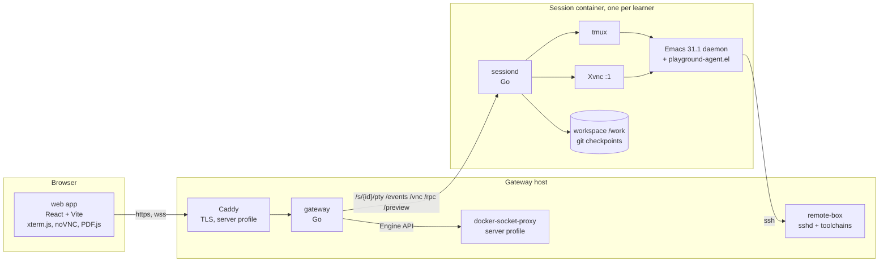

# Emacs Playground — design overview

Status: slice 1 is implemented: the session image with the slice-1 modules, sessiond, the gateway in local mode, every web screen including the GUI and preview panes, and Parts 0 to 3 of the curriculum. The server-mode docker backend is experimental and OIDC answers 501 (§10). Where a document and the code disagree, the code is authoritative; AGENTS.md lists the commands and invariants, and notes.md the developer workflow and known limitations.

Emacs Playground is a browser-based, hands-on Emacs course built around a real, fully configured Emacs that runs in a container. Learners do real development work in Rust, OCaml, Python, Markdown, Typst and LaTeX inside it. Every keystroke is explained as it happens, the interface always knows how to get the learner out of a confusing state, and any step can be reset and retried.

This document is the map: goals, principles, the system at a glance, the technology choices and why, the decision log and the roadmap. Each concern has one detailed document.

## 1. Reading guide

| Document | What it covers | Read it if you |
|---|---|---|
| [architecture.md](architecture.md) | components, process model, data flows, state machines, failure handling, performance budgets | implement or review anything |
| [deployment.md](deployment.md) | images, Compose files, the configuration file, local and server operations, security model | run it, or set up a dev loop |
| [backend.md](backend.md) | Go services: gateway, sessiond, playctl; packages, interfaces, lifecycle, step engine, checkpoints, testing | work on the backend |
| [api.md](api.md) | every HTTP and WebSocket endpoint, event, RPC and the agent socket protocol, with schemas | work on either side of the wire |
| [emacs.md](emacs.md) | the session image, toolchains, configuration modules, terminal and GUI frames, package pinning, and `playground-agent.el` | work on the Emacs side |
| [frontend.md](frontend.md) | React + Vite app: screens, state, connection layer, terminal and VNC panes, advice engine, lesson rendering, styling, testing | work on the frontend |
| [CURRICULUM.md](CURRICULUM.md) | the course (parts, lessons, projects) and the authoring format (Markdown dialect, scenario schema, checks, tables, validation) | write lessons, or build the step engine |
| [third-party.md](third-party.md) | every external piece of software with version, license, link and caveats | audit dependencies |

The clickable design demo is in `../design/demo/` (open `index.html`), screenshots in `../design/screenshots/`; the real system's events and advice follow the demo's shapes. Deployment configuration starts from `../deploy/config.example.json`. `feedback/` keeps dated reviews and fix plans; they are history, not specification.

## 2. Goals

- Learn by doing real work. Each part ends in a project that mirrors a VS Code workflow; the last projects mix languages on purpose.
- Live feedback. A key ticker names each chord, the command it ran and what that means. A "Where am I" panel reads real Emacs state and shows the one exit from it.
- Progressive configuration. Part 0 runs close to vanilla Emacs; modules unlock as they are taught; the learner leaves with a complete, documented config.
- Safe retry. Each step records a checkpoint of files, unsaved buffer text and Emacs layout. Rescue fixes UI state without touching files; Reset restores the checkpoint.
- Two deployments, one set of images: a single-learner local run and a multi-learner server.
- Cover the daily VS Code workflow (files, windows and layouts, git, language servers, debugging, terminals, search and bulk editing, remote editing, previews, input methods, icons and fonts, package management) and then what only Emacs does well: Org-mode, text as the universal interface, and packages that compose because everything is a buffer.
- The environment stands on its own: the session image is a complete Emacs development environment usable from any terminal.

Non-goals for v1: collaborative sessions, an evil-mode track, billing, phone layouts.

## 3. Principles

1. Read state, never guess intent. Hints come from what Emacs reports, not from classifying mistakes (architecture.md §4).
2. Emacs is the hero. The browser chrome is a book margin: quiet, legible, never covering the Emacs pane.
3. Built-in first. Eglot, project.el, tree-sitter modes, which-key, use-package, package.el, TRAMP, Dired. Alternatives are taught, not imposed.
4. One source of truth per fact. Go defines the wire protocol and the configuration schema; TypeScript types and the JSON Schema are generated. The curriculum defines lessons; the gateway serves them; sessiond evaluates them.
5. Everything resettable. Containers are disposable, workspaces are git repositories, Emacs is a daemon that restarts with buffers restored.
6. Small, boring dependencies. Standard library where it is good enough; a dependency only when it removes a class of bugs.

## 4. System at a glance



| Component | Language | Runs in | Responsibility | Detail |
|---|---|---|---|---|
| web | TypeScript, React 19, Vite | browser | lesson, project and course-map screens; terminal and GUI panes; ticker, Where am I, nudges; preview | frontend.md |
| gateway | Go | gateway container | auth, session lifecycle, routing to sessions, curriculum bundle, progress store, static assets | backend.md §2, api.md §2 |
| sessiond | Go | each session container | supervises Emacs, tmux and Xvnc; PTY, events, VNC and RPC endpoints; input tap; step engine; checkpoints; preview files | backend.md §3, api.md §3 |
| playground-agent.el | Elisp | inside Emacs | reports state and commands; rescue, check, reset, snapshot, module switching | emacs.md §10 |
| session image | Dockerfile | registry | Emacs 31.1, toolchains, config modules, fonts, prefetched dependencies | emacs.md §1 to §9 |
| remote-box | Dockerfile | gateway host | SSH target for TRAMP lessons and deploy tasks (logins from M6) | deployment.md §6 |
| playctl | Go | developer machine, CI | validate, build and replay the curriculum; config schema and check; TypeScript protocol types; web fonts | backend.md §4 |
| curriculum | Markdown, YAML | gateway bundle | lessons, projects, fixtures, exit and habit tables | CURRICULUM.md Part B |

## 5. Deployment modes

Local. `make local` writes `.env` and a minimal `deploy/config.json`; `docker compose up` starts the gateway, one session container and the remote box. The gateway uses the static backend (no auth, one fixed session). The workspace is bind-mounted from `./workspace`, so projects and the learner's growing config survive restarts and can be copied to a real machine. A native terminal can attach to the same Emacs with `make shell`.

Server. `make server` selects the server Compose overlay, which adds Caddy for TLS and a Docker socket proxy. The gateway uses the docker backend: it authenticates learners (invite codes; OIDC later), creates one hardened session container per learner on that session's own internal network, gives each a named volume, proxies traffic, stops idle sessions and keeps volumes for a retention period. All settings live in `deploy/config.json` (deployment.md §3).

## 6. The flows that matter

- Keystroke to ticker: xterm.js sends bytes to `/pty`; sessiond's input tap decodes them and emits `prefix` immediately; Emacs runs the command; the agent emits `key` and `state`; the browser renders the chord, the command and a gloss (architecture.md §3.1).
- Step evaluation: sessiond holds the active step; on each agent or file event it re-evaluates the step's ordered conditions and emits `check`; the browser shows the next condition and its hint (architecture.md §3.2).
- Rescue and reset: Rescue calls the agent's rescue op, which only changes UI state. Reset restores the step's git ref, unsaved buffer text and session variables, and re-applies the buffer and window spec (architecture.md §3.4).
- Frame switch: the same Emacs daemon serves a terminal frame and a GUI frame; switching shows the other frame with buffers untouched (architecture.md §3.5).
- Session creation on a server: login, `POST /api/v1/sessions`, container created through the socket proxy, health polled, WebSockets opened (architecture.md §3.7).

## 7. Technology choices

| Area | Choice | Record |
|---|---|---|
| Backend | Go 1.26; standard `net/http` mux, `coder/websocket`, `creack/pty`, the official Docker client (`moby/moby/client`), `fsnotify`, `modernc.org/sqlite` | ADR-004, ADR-015, ADR-016 |
| Frontend | React 19, Vite 8, TypeScript 5.9, Zustand, TanStack Query, React Router 7, CSS Modules over design tokens; protocol types generated from Go | ADR-005, ADR-014, ADR-019 |
| Terminal | xterm.js 6.1 beta; CSI u for chords the legacy encoding cannot carry; tmux `extended-keys always` (`csi-u`); `kkp.el` in Emacs | ADR-007 |
| Emacs | 31.1 from source, Lucid toolkit, native compilation, tree-sitter; one daemon, two frame kinds | ADR-001, ADR-006 |
| Editor stack | vanilla keys, Eglot, package.el + use-package, vertico, consult, corfu, Magit | ADR-002, ADR-003 |
| Hints | layered: state exits, habit translation and stuck patterns, per-step ordered conditions, reset | ADR-008 |
| Checkpoints | git refs under `refs/playground/` plus a buffer and window spec, unsaved buffer text and session variables | ADR-009 |
| Curriculum delivery | versioned bundle served by the gateway; fixtures fetched on scenario load; lessons self-test in CI | ADR-010, ADR-017 |
| Auth and config | gateway-native invite codes and OIDC; Caddy only for TLS; one JSON configuration file | ADR-011, ADR-018 |
| Session isolation | a network per session; sessiond answers only its gateway (proxy secret) | ADR-020 |
| Configuration modules | unlock monotonically: a lesson adds modules, never removes them | ADR-021 |
| Step evaluation | in sessiond, never in the browser | ADR-012 |
| Prefix feedback | input tap in sessiond, agent authoritative | ADR-013 |

## 8. Decision records

Each record: context, decision, consequences.

- ADR-001 Terminal frame first, GUI frame for media. Context: crisp text, faithful keys and cheap sessions matter most; PDFs and images need a GUI. Decision: default to a terminal frame in tmux, offer a GUI frame over Xvnc and noVNC on demand, same daemon. Consequences: two render paths in the browser; extended key encoding needed for modifier-rich chords (ADR-007); VNC fidelity accepted for media lessons only.
- ADR-002 Vanilla Emacs keys. Context: the goal is to learn Emacs; evil adds a second model. Decision: vanilla bindings throughout; an evil track may come later as a module. Consequences: VS Code muscle memory conflicts are handled by the habit translator rather than by rebinding.
- ADR-003 Built-in first for the editor stack. Decision: Eglot over lsp-mode, package.el + use-package over elpaca or straight, project.el over projectile; alternatives are shown in Part 13. Consequences: what the learner learns transfers to any Emacs; some conveniences of the alternatives are not used.
- ADR-004 Go for the gateway and sessiond. Context: a widely used, maintainable backend language with a strong standard library and simple deployment. Decision: one Go module, static binaries, stdlib mux, a short dependency list. Consequences: `creack/pty` and `coder/websocket` for the two things the stdlib lacks; type generation to TypeScript (ADR-019).
- ADR-005 React + Vite for the web app. Consequences: Zustand for live state, TanStack Query for server state, CSS Modules over the demo's tokens.
- ADR-006 One Emacs daemon, two frame kinds. Context: switching between terminal and GUI must not lose buffers; `C-x C-c` must not lose work. Decision: `emacs --fg-daemon`, `emacsclient -t` in tmux, `emacsclient -c` on Xvnc. Consequences: sessiond respawns frames; daemon restarts restore buffers from snapshots.
- ADR-007 Extended keys as CSI u. Context: the legacy terminal encoding cannot carry chords Emacs binds (`C-;`, `C-=`, `C->`, `C-RET`, `C-S-a`, …), and tmux never forwards Emacs's kitty-keyboard push to the outer terminal, so xterm.js stays in the legacy encoding. Decision: the terminal pane sends CSI u itself for exactly the chords legacy cannot express (frontend.md §5); tmux runs `extended-keys always` with `extended-keys-format csi-u`; `kkp.el` decodes them in Emacs; sessiond's input tap decodes them for the ticker. xterm.js is pinned to a 6.1 beta. Consequences: everything legacy can express keeps its legacy bytes; adding a chord means adding it to the pane's encoder.
- ADR-008 Layered hints, state-based first. Context: learners fail in endless ways; Emacs has few input-swallowing states. Decision: exits table over real state, habit and stuck rules over the key stream, ordered per-step conditions, reset as the fallback. Consequences: lesson authors write goals, not mistakes; tables grow with modules.
- ADR-009 Git-based checkpoints. Decision: `refs/playground/<lesson>/<step>` over the workspace with a temporary index, plus a buffer and window spec, the unsaved text and undo history of file buffers, and the session variables steps rely on (kill ring, histories, keyboard macro); restore keeps build directories and `emacs.d/modules.el`. Consequences: the learner's staging area is reset by a restore; Magit lessons checkpoint after staging; a lesson that depends on more session state adds a variable to the captured set (backend.md §3.9).
- ADR-010 Curriculum bundle separate from images. Context: lessons change more often than Emacs. Decision: the gateway serves a versioned bundle; sessiond fetches fixtures on scenario load. Consequences: fixture fetch is a runtime dependency on the gateway; cached per session.
- ADR-011 Gateway-native auth. Decision: invite codes and OIDC inside the gateway; Caddy only terminates TLS. Consequences: fewer containers; the gateway owns cookies and CSRF.
- ADR-012 Steps evaluated in sessiond. Context: conditions need Elisp, files and shell access; progress must survive a closed tab. Decision: sessiond evaluates and reports progress; the browser only renders. Consequences: the frontend has no lesson logic beyond hint selection and the exit table (`session.*` rows are browser-only).
- ADR-013 Input tap in sessiond for prefix feedback. Context: Emacs cannot report a half-typed chord without timers; the terminal bytes and RFB key events are visible to sessiond anyway. Decision: decode input in sessiond; the agent remains authoritative for command names. Consequences: two decoders to maintain; instant feedback even when Emacs is busy.
- ADR-014 CSS Modules over the design tokens, no utility framework. Context: the demo's visual identity should survive; the component set is small. Consequences: a dark chrome theme is a token swap later.
- ADR-015 SQLite for the gateway store, JSON file in local mode. Consequences: single host in v1; migration to Postgres only if multi-host arrives.
- ADR-016 Standard library HTTP mux. Context: Go 1.22 patterns cover method routing and path parameters. Consequences: no router dependency; middleware as plain functions.
- ADR-017 Lessons must solve themselves. Decision: every step ships a `demo` key string; `playctl curriculum play` replays it (also as a "Watch it" demonstration with `-watch`) and requires the step to complete. The same player drives "Watch it", "Skip this step" and the fast-forward of "Go to this step". Consequences: condition bugs and fixture drift are caught before release.
- ADR-018 One JSON configuration file for deployment. Decision: `deploy/config.json` with defaults, environment overrides and flags; secrets by file reference; schema generated from Go. Consequences: `.env` shrinks to Compose selection, image base, tag and domain.
- ADR-019 TypeScript types generated straight from Go. Decision: `internal/protocol/tsgen` reflects over the protocol structs and reads enum constants and doc comments from the Go AST, producing string-literal enums, an `Event` union discriminated by `t` and an `RpcOps` map; JSON Schema (invopop/jsonschema) is used only for `deploy/config.schema.json`. Consequences: `web/src/protocol.gen.ts` is never edited by hand; `go test ./internal/protocol/...` fails when it is stale.
- ADR-020 Per-session isolation in server mode. Context: learners run arbitrary code; a shared network would let one session reach another's sessiond. Decision: each session container gets its own internal network `pg-net-<id>` that only the gateway joins, and sessiond refuses every request but `/healthz` without the session's proxy secret, an HMAC of the session id the gateway derives and sends. Consequences: the gateway joins one network per session and re-joins them after it is replaced; local mode (one session, no secret) is unchanged (deployment.md §7, §9.3).
- ADR-021 Configuration modules unlock monotonically. Context: a learner going through the course gains modules; rolling them back on replay would surprise them and restart Emacs. Decision: a scenario's `modules` are added to the current set, never removed; checkpoint restores keep `modules.el`. Consequences: every lesson must pass with more modules than it lists (emacs.md §4); replays on a fresh workspace match the learner's path.

## 9. Repository layout

```
compose.yaml  compose.local.yaml  compose.server.yaml  .env.example  Makefile
compose.dev.yaml (make dev: the session on the host network)
deploy/        config.json (local)  config.dev.json  config.example.json (server)  config.schema.json (generated)
               Caddyfile  invites.example.txt  secrets/ and invites.txt (git-ignored)
go.mod         module github.com/floatshadow/emacs-playground
cmd/gateway  cmd/sessiond  cmd/playctl
internal/      Go packages (backend.md §1); protocol/ is the wire contract, protocol/tsgen the TypeScript generator
web/           React + Vite app (frontend.md §1); e2e/ browser scenarios; dev/ the fake session
emacs.d/       the Emacs config and playground-agent.el (emacs.md §3)
curriculum/    lessons, fixtures, tables (CURRICULUM.md Part B)
images/{session,remote-box,gateway}/Dockerfile
.github/workflows/  ci.yml  image-emacs.yml  image-web.yml  release.yml
design/demo  design/screenshots
docs/          specification; notes.md developer notes; history/ completed reviews and fix plans
workspace/  artifacts/  .dev/   (git-ignored) local workspace, test screenshots, make dev state
```

## 10. Roadmap

Slice 1 delivers M1 to M3, the slice-1 part of M0 (Rust and Python; the other toolchains and modules are stubs) and the GUI and preview panes; the rest is open (notes.md §5).

| Milestone | Deliverable | Done when |
|---|---|---|
| M0 | session image and config | `docker run -it … emacs -nw` gives the full environment; every language server attaches in a sample project; GUI frame renders a PDF under Xvnc; `packages.lock` reproducible |
| M1 | sessiond, gateway in local mode, web terminal | browser shows the tmux-backed frame; refresh reconnects; extended keys verified end to end; clipboard both ways; `make local` works from a clean clone |
| M2 | agent, input tap, ticker, Where am I, nudges | events flow end to end; every exits row and pattern rule passes a scripted test; prefix latency under 20 ms |
| M3 | step engine, checkpoints, Parts 0 to 3 | scenario load, checks, hints, checkpoint and reset work; `playctl curriculum play` passes for every shipped lesson |
| M4 | preview pane, Parts 4 to 10 | Markdown, Typst and LaTeX previews reload on save; Org export lands in the preview; Babel runs all four languages |
| M5 | GUI frame, Parts 8.4, 8.5 and 11 | pdf-tools and image lessons over noVNC; frame switch keeps buffers; composition lessons pass |
| M6 | remote box, Parts 12 and 13, projects P1 to P8 | TRAMP lessons and every project pass end to end; config clones to a fresh box |
| M7 | server mode | auth, limits, reaping, egress policy; 20 concurrent sessions on one host under load; security checklist reviewed |

Workstreams run in parallel: Emacs side (M0, agent in M2, modules through M6), backend (M1 to M3, M7), frontend (M1, M2, M4, M5), curriculum (M3 onward). Open questions: whether Emacs 31's own terminal key handling can replace `kkp.el`; whether vterm joins eat (the default terminal) in the terminals module.

## 11. Glossary

- Buffer, window, frame: Emacs terms. A buffer holds text; a window shows a buffer; a frame is what the OS calls a window. The playground has two frames of one Emacs.
- Session: one learner's running environment: a container with sessiond, Emacs, tmux, optionally Xvnc, and a workspace.
- Workspace: the learner's files at `/work`, a git repository, including the config and playground state under `/work/.playground`.
- Scenario: the machine-readable part of a lesson: fixtures, setup, steps with conditions and hints.
- Step, condition: a step is a goal; its ordered conditions are checked by sessiond; the first unmet one selects the hint.
- Checkpoint: a git ref over the workspace plus a buffer and window spec, unsaved buffer text and session variables, taken when a step starts.
- Agent: `playground-agent.el`, the minor mode that reports Emacs state to sessiond.
- Input tap: sessiond's decoder of terminal bytes and VNC key events into key names.
- Lesson id: the lesson directory relative to `curriculum/`, e.g. `02-buffers-and-files/03-opening-files`; it goes into URLs with its slash.
- Ticker, Where am I, nudges: the three live panels (frontend.md §6).
