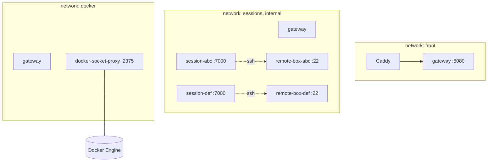
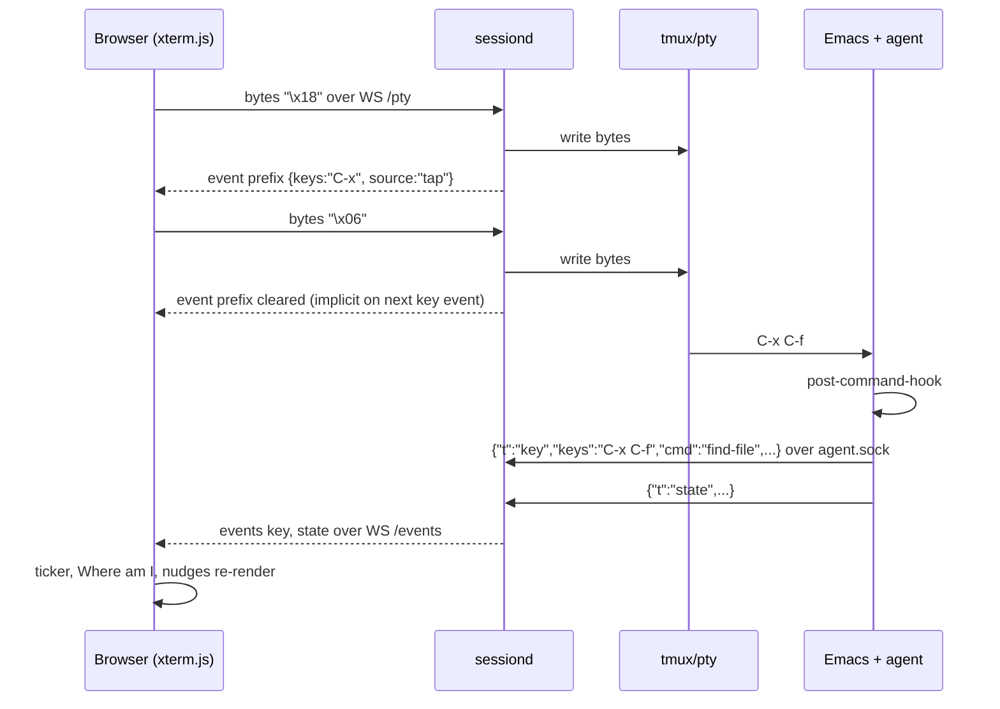
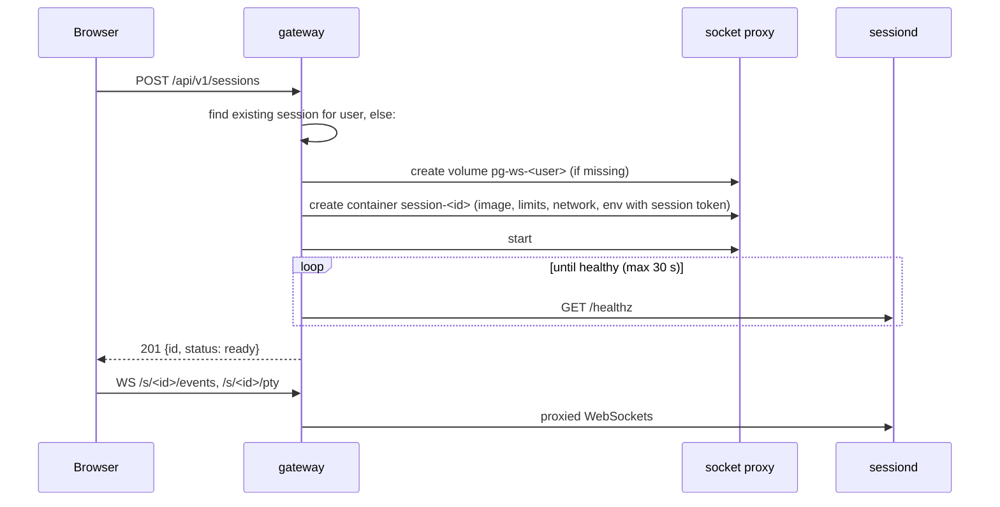

# Architecture

Components, runtime topology, data flows, state machines, failure handling and performance budgets. Protocol details are in api.md; internals of each service in backend.md, emacs-agent.md and frontend.md.

## 1. Components and networks



The gateway is the only component on more than one network. Session containers can reach the gateway (for fixtures and progress reporting) and their own remote box; they cannot reach each other or the Docker socket. In local mode there is one session container started by Compose and no proxy or Caddy.

Inside a session container the process tree is:

```
tini (PID 1)
└── sessiond
    ├── emacs --fg-daemon=playground            # the one Emacs; all buffers live here
    ├── tmux new-session -d -s emacs            # tmux server, status line off, prefix unbound
    │   └── emacsclient -t -s playground        # terminal frame, respawned if it exits
    ├── Xvnc :1 (on demand)                     # GUI frame display
    │   └── emacsclient -c -s playground        # GUI frame
    ├── tmux attach -t emacs (one per /pty)     # attached on a pty owned by sessiond
    ├── sh -c "<check>" (short-lived)           # shell conditions, as user learner
    └── git ... (short-lived)                   # checkpoints
```

sessiond listens on `:7000` inside the container and on the Unix socket `/run/playground/agent.sock` for the Emacs agent.

## 2. Data ownership

| Data | Owner | Where | Lifetime |
|---|---|---|---|
| Learner files, config, build artefacts | learner | `/work` (bind mount or named volume) | until the volume is deleted; server: retention period after last use |
| Checkpoints | sessiond | `refs/playground/*` in `/work/.git` | with the workspace |
| Playground state (active lesson, module set, stuck dumps, event log) | sessiond | `/work/.playground/` | with the workspace |
| Progress (lessons and steps done, hints used, resets) | gateway | SQLite (server) or `data/progress.json` (local) | until the user is deleted |
| Users, sessions registry, invite codes | gateway | SQLite | operator-managed |
| Curriculum bundle | gateway | `curriculum.json` + fixture tarballs, versioned | replaced on upgrade |
| Session container, Xvnc, tmux | sessiond, gateway | ephemeral | recreated at will |

Nothing in a container is precious. Everything precious is in the workspace volume or the gateway data volume.

## 3. Flows

### 3.1 Keystroke to ticker



The input tap gives sub-10 ms feedback for pending prefixes even while Emacs is busy. The agent is the authority for command names and state; a `key` event from the agent supersedes any tapped prefix. In the GUI frame the tap decodes RFB KeyEvent messages on the `/vnc` bridge instead of terminal bytes.

### 3.2 Step evaluation

sessiond holds the active scenario and step. Evaluation is triggered by agent events (`key`, `state`), file events, and a 2 s tick for time-based stuck rules, debounced to at most one evaluation per 150 ms.

For each condition in order: `event` conditions are answered from sessiond's command counter since the step started; `file` conditions from the workspace; `shell` conditions by running the command with a 5 s timeout as the learner user; `elisp` conditions are batched into one agent `check` call. Results are emitted as a `check` event. When all conditions hold, `step` with `status: complete` is emitted, progress is reported to the gateway, and the next step's checkpoint is taken.

The browser never evaluates conditions. It renders the latest `check` and selects the hint for the first unmet condition from the scenario it already has.

### 3.3 Scenario load

`POST /rpc/scenario {lesson, step}`:

1. sessiond fetches the scenario JSON and the fixture tarball for the lesson from the gateway (`GET /internal/curriculum/...`, cached under `/work/.playground/cache`).
2. If the scenario's `modules` differ from the current set, it writes `modules.el` and restarts the Emacs daemon with buffers restored (see §5.2).
3. It extracts fixtures into `/work/<root>` without overwriting learner files unless `setup.reset: true`.
4. It asks the agent to run `setup.open`, `setup.layout`, `setup.eval`.
5. It records a checkpoint `refs/playground/<lesson>/<step>` and emits `step {status: loaded}`.

### 3.4 Rescue and reset

Rescue (`POST /rpc/rescue`): one agent call, `playground-rescue`, which in order aborts minibuffers and recursive edits, ends isearch, cancels a running macro definition, disables overwrite mode, widens, deletes other windows keeping a file-visiting window, buries special buffers, and reports what it did. Files are never touched.

Reset (`POST /rpc/restore {label}`): sessiond runs `git restore --source=<ref> --worktree --staged -- .` and `git clean -fd` with the project's ignore list (`target/`, `_build/`, `.venv/`, `.playground/` are kept), then asks the agent to `reset-step` with the spec stored next to the ref: revert visiting buffers, kill buffers for files that no longer exist, reopen the listed files, apply the layout.

### 3.5 Frame switch

`POST /rpc/mode {mode: "gui"}`: sessiond starts Xvnc if needed, runs `emacsclient -c -s playground` with frame parameters for 1600×900, waits for the agent's `frame-opened` event and emits `mode`. The browser swaps the terminal pane for the VNC pane. The terminal frame keeps running; switching back is instant. Buffers, point and marks are shared because both frames belong to one daemon.

### 3.6 Preview reload

fsnotify on `/work` (recursive, excluding `.git`, `target/`, `_build/`, `.venv/`, `node_modules/`) emits `file` events debounced per path at 200 ms. The preview pane reloads the iframe for the file it shows. PDFs are rendered by PDF.js with scroll and zoom preserved across reloads; HTML and images reload in place; Markdown is rendered by the browser from the raw file.

### 3.7 Session creation on a server



A session is re-used while its container runs. Idle sessions (no WebSocket for `PG_IDLE_STOP_MINUTES`) are stopped; a stopped session is re-created from its volume on the next request. Removal of volumes happens after `PG_VOLUME_RETENTION_DAYS`.

### 3.8 Reconnect

The browser reconnects WebSockets with exponential backoff (250 ms to 8 s). `/pty` reattaches to the same tmux session, so the screen is restored by tmux. `/events` resumes from the last seen `seq` with `?after=<seq>`; sessiond keeps a ring buffer of 500 events and replays the gap, or sends a fresh `hello` and `state` if the gap is too old.

## 4. Where advice comes from

| Layer | Input | Who computes | Output |
|---|---|---|---|
| State exits | latest `state` event | browser, `advice/exits.ts` with rows from `tables/exits.yaml` | "Where am I" rows: a reason and one exit |
| Habit translation and stuck patterns | last N `key` events, timestamps, `state` | browser, `advice/habits.ts`, `advice/patterns.ts` | dismissible cards |
| Step conditions | scenario, `check` events | sessiond evaluates, browser selects the hint | step list, next condition, hint |
| Reset | checkpoint refs | sessiond + agent | restored files and layout |

The tables are data; the engine is a few pure functions that the demo already implements. New special modes add rows, not code.

## 5. State machines

### 5.1 Session (gateway, server mode)

```
requested → creating → starting → ready ⇄ idle → stopping → stopped → removed
                 │          │                    (volume kept)   (after retention)
                 └──error───┴──────────────────────────────────────→ failed
```

`ready` has at least one WebSocket; `idle` has none. `stopped` keeps the volume and progress; a new request moves it back to `creating`.

### 5.2 Emacs supervision (sessiond)

```
daemon: starting → ready → (exited) → restarting (backoff 1, 2, 4, 8 s, max 5 in 10 min) → ready
terminal frame: attached → (client exited) → respawn emacsclient -t within 500 ms → attached
gui frame: absent → starting Xvnc → frame opened → (closed) → absent
```

A daemon restart re-opens the files recorded in the last checkpoint spec and the last `state` snapshot (visible buffers and point positions), so an unexpected daemon death loses at most unsaved edits since the last auto-save (`auto-save-visited-mode` is on with a 5 s interval).

### 5.3 Step

```
loaded → checking → complete
   ↑        │
   └─reset──┘
```

## 6. Failure modes

| Failure | Detection | Recovery | Learner sees |
|---|---|---|---|
| Emacs daemon dies | agent socket closes; process exit | restart with buffer restore | overlay "Emacs restarted; your files are safe", event log entry |
| Terminal frame closed (C-x C-c) | emacsclient exits | respawn | overlay explaining C-x C-c, frame back within a second |
| Emacs hangs (busy loop, TRAMP timeout) | agent heartbeat missing 5 s | sessiond sends SIGUSR2 (debug-on-event) then offers Rescue which sends C-g via tmux | "Emacs is busy" banner, Rescue available |
| Agent socket broken | reconnect attempts | agent reconnects with backoff; tap still gives prefixes | ticker shows keys without command names, warning chip |
| WebSocket drops | close event | reconnect with backoff, event replay | brief "reconnecting" chip |
| Container OOM-killed | gateway inspect | re-create from volume | "Your session restarted" with the last checkpoint offered |
| Gateway restarts | health | sessions keep running; registry rebuilt from container labels | reconnect |
| Fixture fetch fails | HTTP error | retry 3×, then `error` event | lesson shows "could not load files", retry button |
| Shell check hangs | timeout 5 s | condition reported as unknown | step waits; hint unaffected |

## 7. Performance budgets

| Path | Target | Notes |
|---|---|---|
| key press to screen update, terminal frame | < 30 ms local, < 80 ms server on the same continent | xterm.js webgl, tmux `escape-time 0` |
| key press to ticker prefix | < 20 ms | input tap, no Emacs involvement |
| command to ticker entry | < 100 ms | agent post-command-hook, JSON, WS |
| step evaluation | < 300 ms after the last event | debounce 150 ms, elisp checks batched |
| session creation, warm image | < 10 s | daemon start dominates; native-compiled config |
| GUI frame start | < 3 s | Xvnc + emacsclient -c |
| session memory, typical | 1.0 to 1.5 GB | Emacs with LSP servers; cap 3 GB |
| session CPU, idle | < 1 % | no polling loops; fsnotify, hooks only |

## 8. Scaling

One host per deployment in v1. A 96-core, 440 GB host runs about a hundred concurrent sessions at the default limits. Beyond that, the gateway's `Backend` interface (backend.md §2.3) admits a second implementation that schedules sessions across hosts or on Kubernetes; the session container contract does not change.
