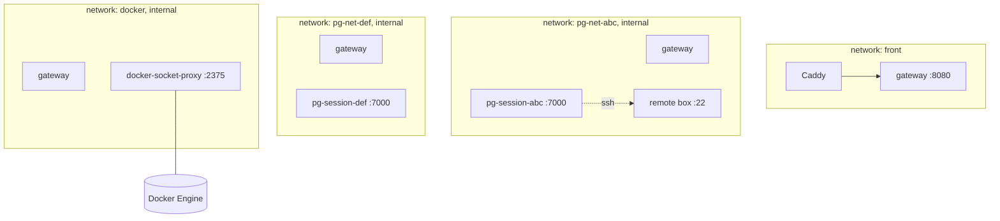
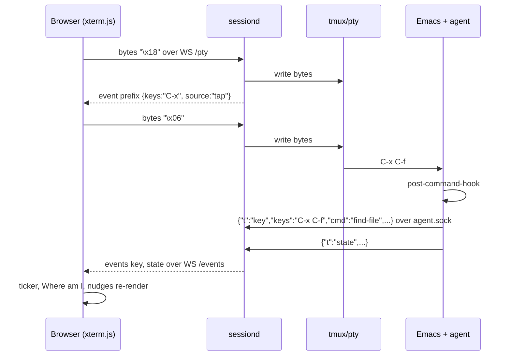
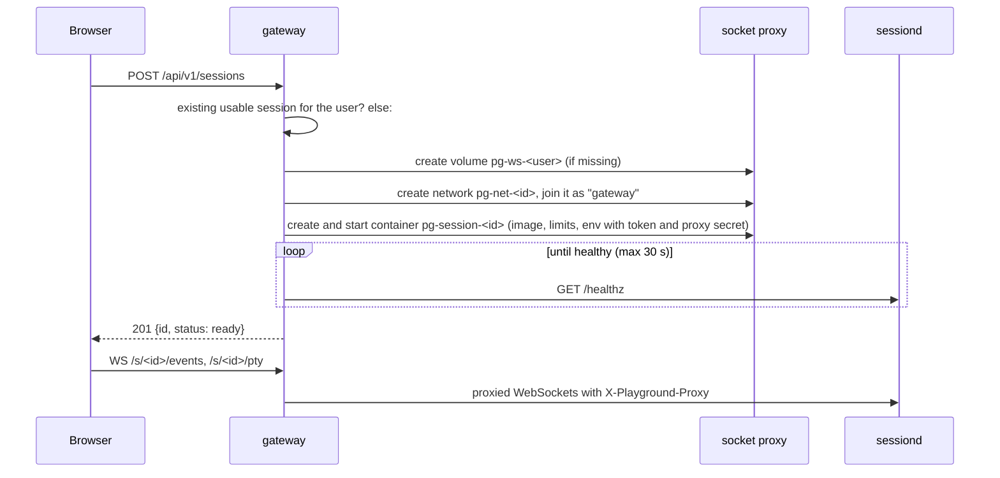

# Architecture

Components, runtime topology, data flows, state machines, failure handling and performance budgets. Protocol details are in api.md; the internals of each part in backend.md, emacs.md and frontend.md.

## 1. Components and networks



Server mode. The gateway is the only component on more than one network. Every session has its own internal network `pg-net-<id>` (deployment.md §7) that only the gateway, that session and its remote box join: a session reaches the gateway (fixtures, progress, stuck reports) and nothing else of the playground. sessiond also refuses every request but `GET /healthz` that lacks its session's proxy secret, which the gateway adds (deployment.md §9.3), so reaching another session's port is not enough to drive it.

Local mode. One session container and one remote box (alias `box`) started by Compose on the shared internal `sessions` network, no proxy secret, no socket proxy or Caddy. `make dev` runs the session on the host network and the gateway from source.

Inside a session container:

```
tini (PID 1)
└── sessiond
    ├── emacs --fg-daemon=playground              # the one Emacs; all buffers live here
    ├── tmux -L pg new-session -d -s emacs        # status line off, prefix unbound, remain-on-exit on
    │   └── emacsclient -t -s playground          # terminal frame; the pane is respawned when it exits
    ├── tmux -L pg attach-session -d -t emacs     # one per /pty WebSocket, on a pty owned by sessiond
    ├── Xvnc :1 (GUI mode only)                   # 127.0.0.1:5901, reached only through /vnc
    │   └── emacsclient -c -s playground          # GUI frame
    ├── sh -c "<check>" (short-lived)             # shell conditions
    └── git … (short-lived)                       # checkpoints
```

sessiond listens on `:7000` and on the Unix socket `/run/playground/agent.sock` for the Emacs agent. Everything runs as `learner` (uid 1000).

## 2. Data ownership

| Data | Owner | Where | Lifetime |
|---|---|---|---|
| Learner files, config, build output | learner | `/work` (bind mount `./workspace` or volume `pg-ws-<user>`) | until the volume is deleted; server: retention period after last use |
| Checkpoints (git refs and their manifests: window spec, unsaved text and undo, session variables) | sessiond snapshot service | `refs/playground/*` in `/work/.git`, manifests in `/work/.playground/checkpoints/` | with the workspace |
| Last editor state, the one every recovery reopens | sessiond snapshot service | `/work/.playground/snapshot.json` | with the workspace |
| Lesson lifecycle (loaded lesson, active step, phase, attempt, saved outcomes, lap, lesson op in progress) | sessiond session core, its only writer | in memory; active step, outcomes and lap in `/work/.playground/state.json` (version 2); published to browsers as the lesson snapshot (in `hello`, the `status` RPC and `lesson` events; api.md §4.1); the browser renders it and never derives these facts from events or progress | with the workspace |
| Progress not yet accepted by the gateway, reset generations applied | sessiond progress outbox, changed only under the core's lock | `state.json`, written from one reading of core and outbox | with the workspace |
| Condition results, command counts, key-stream statistics of the current attempt | sessiond evaluator (`steps.Evaluator`) | in memory | one attempt |
| Module set; scenario and fixture cache; event log | sessiond | `/work/emacs.d/modules.el`; `/work/.playground/cache`; `/work/.playground/events.log` | with the workspace |
| Live editor state (buffers, windows, tabs, menus) | Emacs and its agent | the daemon | until the daemon stops |
| Progress (steps done, demonstrated, skipped; hints used; resets) | gateway | `<dataDir>/local.json` (local) or `<dataDir>/playground.db` (SQLite, server) | until the user is deleted |
| Users (OIDC claims), session registry | gateway | same store | operator-managed |
| Curriculum bundle | gateway | `curriculum.dir`: `curriculum.json`, per-lesson bundles, `fixtures/<id>.tar.zst`; built into the gateway image | replaced on upgrade |
| Session container, tmux, Xvnc | gateway, sessiond | ephemeral | recreated at will |

Nothing in a container is precious: everything precious is in the workspace or the gateway data volume.

## 3. Flows

### 3.1 Keystroke to ticker



The input tap gives instant feedback for pending prefixes even while Emacs is busy. The agent is the authority for command names (`real-this-command`) and state; its `key` event supersedes any tapped prefix, and `prefix` with `keys: ""` clears one. In GUI mode the tap decodes RFB KeyEvent messages on the `/vnc` bridge instead. The tap drops a lone `ESC` (or other late key) whose bytes arrived before the agent's last command, so it never turns the learner's next `C-x` into `C-M-x` (backend.md §3.6).

### 3.2 Step evaluation

sessiond's session core holds the active scenario and step; every activation begins a new attempt in the evaluator (`steps.Evaluator`), which evaluates only that attempt. Agent events (`key`, `state`, minibuffer), file events and a 2 s tick (time-based stuck rules) trigger an evaluation; the debounce is trailing, 40 ms after the last trigger and at most 120 ms after the first, so key to `check` takes about 50 ms.

Conditions are evaluated in order: `event` from sessiond's command counter since the step (or lesson) started; `state` and `layout` from the latest agent state (`protocol.Predicate`, `protocol.MatchLayout`); `file` from the workspace (or, with `host: box`, the remote box over ssh); `shell` by running the command in the session or on the box (timeout 5 s unless the condition sets one; a long run is `unknown` until it finishes); `elisp` and `buffer` batched into one agent `check` call; `all`, `any`, `not` combine them. A condition that cannot be evaluated is `unknown` (and not met). The evaluator hands each result to the core (`Observe`), which drops results of any other attempt and publishes the rest as a `check` event carrying the attempt. When every condition holds, the core's phase decides: Active records `done` in the progress outbox, publishes `lesson {change: complete}` and queues the `advance` op ahead of any other, which takes the next step's checkpoint before it activates the step and publishes the snapshot (`lesson loaded`); Watching records `demonstrated` once and keeps the step active; Skipping leaves the outcome to the skip op (§5.3).

The browser never evaluates conditions. It renders the latest `check` of the attempt its snapshot shows and selects the hint of the first unmet condition from the scenario it already has.

### 3.3 Scenario load

`POST /rpc/scenario {lessonId, stepId?, reset?, lap?}`; a reload of the active lesson without `reset` or `lap` answers at once without re-running setup. Without `stepId` the load starts at the first step that is neither done nor skipped. Every lesson operation, loads included, is an op of sessiond's session core: one worker runs them one at a time, each to completion within its own deadline even when the request goes away, and a drop jumps the queue and cancels a running op on its lesson (backend.md §3.12). Before every load the core syncs the gateway's reset generations (§3.9).

1. sessiond fetches the scenario and the fixture tarball from the gateway (`GET /internal/curriculum/...`), cached by ETag under `/work/.playground/cache`; when the gateway is unreachable it uses the cached copies.
2. It extracts the fixtures into the lesson root without overwriting the learner's files, unless `reset` (the request's, `setup.reset` or a lap) is set: then edited files are overwritten and files the fixtures do not contain are removed, keeping `target`, `_build`, `.venv`, `node_modules` and `.git`. Then `setup.repos` and `setup.run`; their failures are `error` events, not a failed load.
3. If the union of the current module set and the scenario's `modules` differs from the current set, it writes `modules.el`, emits `modules {restarting: true}` and restarts the daemon (§5.2); the RPC returns `restarting: true` and the load finishes in the background, while later requests queue behind it. `modules {restarting: false}` follows the activation, so the browser holds keys until the lesson is set up. Modules are never removed (DESIGN.md ADR-021).
4. It waits (up to 15 s) for a restart in progress and for the terminal frame, then asks the agent to `setup`: `open`, `layout`, `eval`, `compile` in one call. With `reset` the agent first reverts or kills the buffers of changed or removed files, closes other tabs and clears unmodified leftovers and save-place positions under the root, so a replayed lesson starts on line 1 of its files (emacs.md §10.3).
5. For a step after the first ("Go to this step", or resuming mid-lesson) it restores that step's checkpoint through the snapshot service, or else fast-forwards by replaying the earlier steps' demos while each is rehearsed quietly (phase Rehearsing, §5.3; 10 s per step, 3 minutes in all).
6. It takes the step's checkpoint `refs/playground/<lesson>/<step>` when missing or the fixtures were re-extracted (not after a fast-forward that did not complete every earlier step), activates the step as a new attempt and publishes the lesson snapshot with it (`lesson {change: loaded}`). While the load runs the snapshot's `busy` names it; the rehearsed steps of a fast-forward never appear in it, and a load cut short after a rehearsal puts the step before it back as a new attempt (`lesson {change: phase}`).

### 3.4 Rescue and reset

Rescue (`POST /rpc/rescue`): one agent call that closes an open transient menu, leaves loops reading keys of their own (menus, avy, which-key's pages), prompts and recursive edits, isearch, a keyboard macro being defined, overwrite mode, multiple cursors, iedit, narrowing, the selection and extra windows (never leaving a side window as the frame's only window), and reports what it did. It never saves, kills file buffers or reverts (emacs.md §10.3). When Emacs is too busy to answer, sessiond sends `C-g` through tmux; if Emacs is still unresponsive 10 s later an `error` event (`emacs_unavailable`) offers a daemon restart.

Reset (`POST /rpc/restore`, `{}` for the active step), an op of the session core run by the snapshot service:

1. `git restore --source=<ref> --worktree --staged -- .` and `git clean -fd`, keeping `target`, `_build`, `.venv`, `node_modules` and `.playground`; nested repositories and empty directories recorded with the checkpoint are recreated; `emacs.d/modules.el` is kept.
2. One agent call, `restore-editor`, with the editor state stored with the checkpoint: cancel a pending prefix or prompt and close an open transient menu, revert visiting buffers, kill buffers of files that no longer exist, reopen windows by file, remake Dired, ibuffer, buffer-list and help buffers, restore tabs, and close unmodified workspace file buffers the spec does not list; then put back the unsaved text, undo history and point of file buffers and the session variables steps rely on (kill ring, histories, keyboard macro). Each buffer and part is restored on its own; the failed ones are reported as degraded (backend.md §3.9).
3. sessiond writes the checkpoint's window spec to `snapshot.json`, and the step the checkpoint was taken for restarts as a new attempt, counting a reset (`lesson {change: reset}`).

A failed restore activates nothing; a restore without an agent finishes on its next hello (§6). Once started a restore runs to the end even if the request is cancelled or a drop arrives; a git lock older than 10 s that blocks a command is removed and the command retried once. The snapshot service is the only path to checkpoints and editor state, for every restore entry point (Reset, Do it yourself, Watch it and Skip after a command, Go to this step, restores by label or ref).

### 3.5 Frame switch

`POST /rpc/mode {mode: "gui"}`: sessiond starts Xvnc if needed (`-AcceptSetDesktopSize=1`), runs `emacsclient -c -s playground` at `PG_VNC_GEOMETRY`, waits for the agent's frame report and emits `mode`. The browser swaps the terminal pane for the VNC pane; the GUI frame fits itself to the X screen whenever RandR changes it. The terminal frame keeps running, so buffers, point and marks are shared. Leaving GUI mode deletes the GUI frame and closes Emacs's X connections before Xvnc stops (if that fails Xvnc keeps running rather than dropping under Emacs); `/vnc` closes with 4002 on the switch and 4001 (reconnect) when the display exits while GUI mode is on.

### 3.6 Preview reload

fsnotify watches `/work` recursively (excluding `.git`, `target`, `_build`, `.venv`, `node_modules`, `.playground` and `.#` lock files) and emits `file` events coalesced per path over 200 ms. The preview pane reloads the file it shows: PDFs through PDF.js with scroll and zoom preserved, HTML and images in place, Markdown rendered by the browser from the raw file.

### 3.7 Session creation on a server



`Ensure` is idempotent and serialised per user. A running session is reused; a stopped or failed one is re-created on the same volume with a fresh token. Sessions without a WebSocket turn idle and are stopped after `sessions.idleStopMinutes` (container removed, volume kept); volumes are removed `sessions.volumeRetentionDays` after the session stopped. In local mode the static backend answers with the one Compose session after probing its `/healthz`.

### 3.8 Reconnect

The browser reconnects WebSockets with exponential backoff (250 ms to 8 s, with jitter). `/pty` reattaches to the same tmux session, which redraws the screen; a newer `/pty` viewer replaces the older one (close 4000). `/events` resumes with `?after=<seq>`. The first frame is always a `hello` with the current lesson snapshot, which the page applies whatever its `rev`; then sessiond replays the gap from its ring of 500 events, or, when the gap is older, sends the latest full `state`. A subscriber that falls behind its 256-event buffer gets a `gap` event and reconnects for replay.

### 3.9 Progress delivery and reset

```mermaid
sequenceDiagram
  participant S as sessiond (core, outbox)
  participant G as gateway
  participant B as Browser
  S->>S: outcome recorded under the core's lock, state.json written
  S->>G: POST /internal/sessions/{id}/progress (latest report per step, generation)
  G-->>S: answered (accepted, or rejected with 4xx): the report leaves the outbox; else retry in 1 to 30 s
  B->>G: POST /api/v1/progress/reset {lessonId?} (Start over, or one lesson)
  G->>G: new reset generation
  G->>S: rpc drop-step {lessonId?, generation}
  S->>S: forget outcomes, lap and active step; purge older reports; lesson {change: dropped}
```

The outbox keeps the latest report per step (status, hint and reset totals, a finished lap's id and time) in `state.json` and posts each until the gateway answers, without a deadline. Reports are idempotent, so nothing is acknowledged beyond the HTTP answer: statuses only rise, totals are absolute, a lap counts once per id, and only a reset lowers progress, as a new gateway generation that also discards reports stamped with an older one. A drop that cannot reach a stopped session is caught by the sync op at startup and before every load, which applies the resets the session missed and adopts the gateway's generations; at startup it also queues every saved outcome again, for a gateway whose store was lost or replaced (api.md §2.4, §2.6; backend.md §3.8).

## 4. Where advice comes from

| Layer | Input | Who computes | Output |
|---|---|---|---|
| State exits | latest `state` event and live session facts (`session.*`) | browser, `advice/exits.ts` with rows from `tables/exits.yaml` | "Where am I" rows: a reason and one exit |
| Habit translation and stuck patterns | last N `key` events, timestamps, `state` | browser, `advice/` | dismissible nudges |
| Step stuck rules | the step's `stuck` rules, the attempt's key-stream statistics and time | sessiond session core (paused while a demo plays, a skip runs or a lap is on) | `nudge` events |
| Step conditions | scenario, `check` events | sessiond evaluates, browser selects the hint | step list, next condition, hint |
| Reset | checkpoints | sessiond snapshot service and agent | restored files, buffers and layout |

The tables are data and the engine is a few pure functions; new special modes add rows, not code. Go in `internal/protocol` is the reference for the semantics the browser shares (predicates with regex dialect 1, CURRICULUM.md B.4; templates; demo and key parsing); both sides run the conformance corpus (api.md §8); `MatchLayout` has no browser port.

## 5. State machines

### 5.1 Session (gateway, server mode)

```
creating → starting → ready ⇄ idle → stopping → stopped → removed
    │          │                                (volume kept)  (after retention)
    └──error───┴──────────────────────────────────────────→ failed
```

`ready` has at least one WebSocket; `idle` has none. `stopped` and `failed` keep the volume and progress; a new request re-creates the session.

### 5.2 Emacs supervision (sessiond)

```
daemon: starting → ready → (exited) → restarting (backoff 1, 2, 4, 8 s; at most 5 in 10 min) → ready
terminal frame: open → (client exited, e.g. C-x C-c) → sessiond respawns the tmux pane → open
gui frame: absent → starting Xvnc → frame opened → (closed or mode terminal) → absent
```

`/work/.playground/snapshot.json` holds the agent's buffer and window spec, written by the snapshot service only: by the session core's `autosave` op every 30 s when no op runs or waits, before every planned restart and at shutdown, and by every restore (the checkpoint's spec). Before a planned restart (module change, `restart-emacs`) and at shutdown the agent's `flush-buffers` also saves modified file buffers (never over a file changed on disk; remote and read-only files skipped). A restarted daemon reopens the editor state of a restore still waiting for the agent, else `snapshot.json`: inline in the op that asked for the restart, or after a crash in the core's `recover` op, so the reopen never interleaves with another op. An unexpected daemon death therefore loses at most the edits since the last auto-save (`auto-save-visited-mode`, 5 s).

### 5.3 Step

```
loaded/reset → Active → (conditions hold) → complete → Advancing → next step loaded, or lesson complete
                 │ ├─ demo start → Watching → (conditions hold) → demonstrated (once; step stays active)
                 │ ├─ skip → Skipping → demo played → skipped → Advancing
                 │ └─ reset (Reset this step, Do it yourself, Watch it or Skip after the learner typed)
                 └─ progress reset → dropped → Idle (no active step)
Go to this step without a checkpoint: the earlier steps run as Rehearsing (silent), then the step loads;
a load cut short after a rehearsal makes the step before it Active again with a new attempt.
```

Each activation is a new attempt; an evaluation, demo start or skip of an older attempt changes nothing (demo start and skip answer 409). Demo start and skip first restore the step's checkpoint when a command ran since the step started, and are refused during a lap. Only a completion outside a demonstration counts as `done`; the latch and how a demo ends: api.md §4.1.

Browsers see these states through the lesson snapshot (api.md §4.1): Active and Skipping as `active`, Watching as `watching`, Advancing as `active` on the finished step (or, after the last step, as Idle), Idle as `complete` when every step of the loaded lesson is done or skipped, else `idle`; Rehearsing is never published. Every change publishes a snapshot with a higher `rev`, and `check` events carry the attempt they evaluated, so a page applies only what is newer than what it shows.

## 6. Failure modes

| Failure | Detection | Recovery | Learner sees |
|---|---|---|---|
| Emacs daemon dies | agent socket closes; process exit | restart with backoff (§5.2); the core's `recover` op reopens a waiting restore's editor state, else `snapshot.json` | `emacs restarting` overlay, then the frame back |
| Terminal frame closed (C-x C-c) | sessiond's tmux `pane-died` hook | sessiond respawns the pane (`emacsclient -t`) | overlay explaining C-x C-c, frame back within a second |
| Emacs hangs (busy loop, TRAMP timeout) | 5 missed agent pings (2 s apart) | `emacs unresponsive` event and SIGUSR2 (debug-on-event); Rescue sends C-g; restart offered after 10 s | "Emacs is busy" banner, Rescue available |
| Agent socket broken | socket closed | the agent reconnects with backoff (1 to 16 s); the tap still gives prefixes | ticker shows keys without command names |
| WebSocket drops | close event | reconnect with backoff, event replay | brief "reconnecting" chip |
| Page and session on different protocol versions (an upgrade while the session ran) | `hello.protocol` ≠ the page's `protocol.Version` | the page starts no load, demo or key input (frontend.md §5) | one message offering to stop the session and reload |
| sessiond restarts (container restart, upgrade) | startup | the `resume` op re-activates the step saved in `state.json`: no fixtures, no checkpoint; `snapshot.json` reopened when it shows the lesson's files, else the lesson's setup without reset | the lesson on the same step |
| Restore without an agent, or failing | agent not connected; git or `restore-editor` error (or the agent leaving during it) | without an agent the files are restored, the step activates and the agent's next hello gets the editor state (`reconnect` op) while that attempt is current; a failure activates nothing | buffers catch up when Emacs is back; after a failure an error, and Reset works again |
| Container OOM-killed or gone | inspect, health | re-created from the volume on the next request | reconnect; unsaved edits since the last auto-save are lost |
| Gateway restarts | health | sessions keep running; registry and network membership rebuilt from container labels | reconnect |
| Fixture or scenario fetch fails | HTTP error | retries with backoff, then the cached copy, else an `error` event | "Could not load the lesson files", retry |
| Gateway unreachable, or its store lost or replaced | progress POST fails; the generations sync finds lower generations | the progress outbox keeps each step's latest report in `state.json` and retries (1 to 30 s); every sessiond start sends all saved outcomes again; a report applied twice changes nothing | nothing; progress shows once the gateway is back |
| Progress reset while the session is stopped | `drop-step` fails; the next generations sync | the session forgets the lesson and drops its pending reports; the gateway discards reports of older generations | the lesson starts over on its next load |
| Shell check hangs | timeout | condition reported as unknown | step waits; hint unaffected |

## 7. Performance budgets

| Path | Target | Notes |
|---|---|---|
| key press to screen update, terminal frame | < 30 ms local, < 80 ms server on the same continent | xterm.js WebGL, tmux `escape-time 10` |
| key press to ticker prefix | < 20 ms | input tap, no Emacs involvement |
| command to ticker entry | < 100 ms | agent post-command-hook, JSON, WebSocket |
| last event to `check` | about 50 ms, < 300 ms with Elisp or shell checks | debounce 40 ms trailing, 120 ms max; Elisp checks batched |
| session creation, warm image | < 10 s | daemon start dominates; native-compiled config |
| GUI frame start | < 3 s | Xvnc + `emacsclient -c` |
| session memory, typical | 1.0 to 1.5 GB | Emacs with language servers; cap `sessions.limits.memory` (3 GB) |
| session CPU, idle | < 1 % | no polling loops; fsnotify, hooks, a 2 s agent ping |

## 8. Scaling

One host per deployment in v1. Plan on roughly 1.5 GB of memory per concurrent session at the default limits, so a host with 160 GB runs about a hundred. Beyond that, the gateway's `Backend` interface (backend.md §2.3) admits an implementation that schedules sessions across hosts or on Kubernetes; the session container contract does not change.
