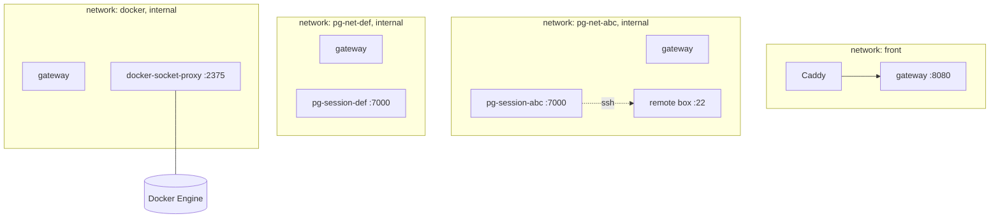
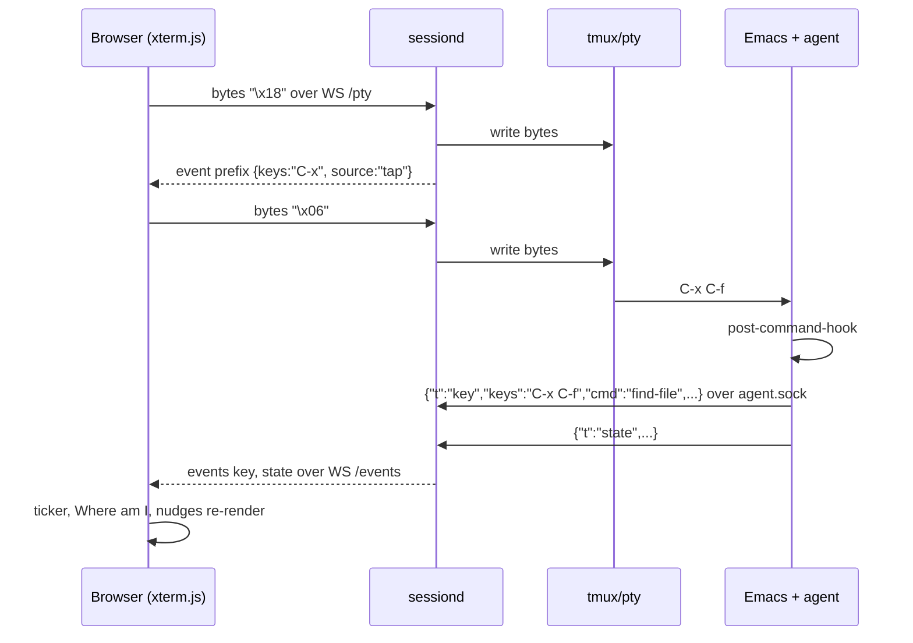
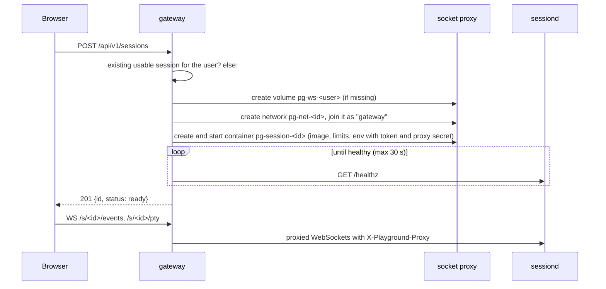

# Architecture

Components, runtime topology, data flows, state machines, failure handling and performance budgets. Protocol details are in api.md; the internals of each part in backend.md, emacs.md and frontend.md.

## 1. Components and networks



Server mode. The gateway is the only component on more than one network. Every session has its own internal network `pg-net-<id>` (deployment.md §7) that only the gateway, that session and its remote box join: a session reaches the gateway (fixtures, progress, stuck reports) and nothing else of the playground. sessiond also refuses every request but `GET /healthz` that lacks its session's proxy secret, which the gateway adds (deployment.md §9.3), so reaching another session's port is not enough to drive it.

Local mode. One session container and one remote box (alias `box`) started by Compose on the shared internal `sessions` network, no proxy secret, no socket proxy or Caddy. `make dev` runs the session on the host network and the gateway from source.

Inside a session container:

```
tini (PID 1)
└── sessiond
    ├── emacs --fg-daemon=playground              # the one Emacs; all buffers live here
    ├── tmux -L pg new-session -d -s emacs        # status line off, prefix unbound, remain-on-exit on
    │   └── emacsclient -t -s playground          # terminal frame; the pane is respawned when it exits
    ├── tmux -L pg attach-session -d -t emacs     # one per /pty WebSocket, on a pty owned by sessiond
    ├── Xvnc :1 (GUI mode only)                   # 127.0.0.1:5901, reached only through /vnc
    │   └── emacsclient -c -s playground          # GUI frame
    ├── sh -c "<check>" (short-lived)             # shell conditions
    └── git … (short-lived)                       # checkpoints
```

sessiond listens on `:7000` and on the Unix socket `/run/playground/agent.sock` for the Emacs agent. Everything runs as `learner` (uid 1000).

## 2. Data ownership

| Data | Owner | Where | Lifetime |
|---|---|---|---|
| Learner files, config, build output | learner | `/work` (bind mount `./workspace` or volume `pg-ws-<user>`) | until the volume is deleted; server: retention period after last use |
| Checkpoints | sessiond | `refs/playground/*` in `/work/.git`, metadata in `/work/.playground/checkpoints/` | with the workspace |
| Playground state (module set, scenario cache, buffer snapshot, event log) | sessiond | `/work/.playground/`, `/work/emacs.d/modules.el` | with the workspace |
| Progress (steps done, demonstrated, skipped; hints used; resets) | gateway | `<dataDir>/local.json` (local) or `<dataDir>/playground.db` (SQLite, server) | until the user is deleted |
| Users, session registry, invite codes | gateway | same store | operator-managed |
| Curriculum bundle | gateway | `curriculum.dir`: `curriculum.json`, per-lesson bundles, `fixtures/<id>.tar.zst`; built into the gateway image | replaced on upgrade |
| Session container, tmux, Xvnc | gateway, sessiond | ephemeral | recreated at will |

Nothing in a container is precious: everything precious is in the workspace or the gateway data volume.

## 3. Flows

### 3.1 Keystroke to ticker



The input tap gives instant feedback for pending prefixes even while Emacs is busy. The agent is the authority for command names (`real-this-command`) and state; its `key` event supersedes any tapped prefix, and `prefix` with `keys: ""` clears one. In GUI mode the tap decodes RFB KeyEvent messages on the `/vnc` bridge instead. The tap drops a lone `ESC` (or other late key) whose bytes arrived before the agent's last command, so it never turns the learner's next `C-x` into `C-M-x` (backend.md §3.6).

### 3.2 Step evaluation

sessiond holds the active scenario and step. Agent events (`key`, `state`), file events and a 2 s tick (time-based stuck rules) trigger an evaluation; the debounce is trailing, 40 ms after the last trigger and at most 120 ms after the first, so key to `check` takes about 50 ms.

Conditions are evaluated in order: `event` from sessiond's command counter since the step (or lesson) started; `state` and `layout` from the latest agent state (`protocol.Predicate`, `protocol.MatchLayout`); `file` from the workspace; `shell` by running the command (timeout 5 s unless the condition sets one); `elisp` batched into one agent `check` call; `all`, `any`, `not` combine them. A condition that cannot be evaluated is `unknown` (and not met). Results go out as a `check` event. When every condition holds the step is `complete` (or `demonstrated` while "Watch it" plays), progress is reported to the gateway, and the next step's checkpoint is taken before its `loaded` event.

The browser never evaluates conditions. It renders the latest `check` and selects the hint of the first unmet condition from the scenario it already has.

### 3.3 Scenario load

`POST /rpc/scenario {lessonId, stepId?, reset?}`; a reload of the active lesson without `reset` answers at once without re-running setup.

1. sessiond fetches the scenario and the fixture tarball from the gateway (`GET /internal/curriculum/...`), cached by ETag under `/work/.playground/cache`; when the gateway is unreachable it uses the cached scenario.
2. It extracts the fixtures into the lesson root without overwriting the learner's files, unless `setup.reset` (or `reset`) is set: then edited files are overwritten and files the fixtures do not contain are removed, keeping `target`, `_build`, `.venv`, `node_modules` and `.git`.
3. If the union of the current module set and the scenario's `modules` differs from the current set, it writes `modules.el` and restarts the daemon (§5.2); the RPC returns `restarting: true` and the load finishes in the background. Modules are never removed (DESIGN.md ADR-021).
4. It waits (up to 15 s) for a restart in progress and for the terminal frame, then asks the agent to `setup`: `open`, `layout`, `eval`, `compile` in one call. With `reset` the agent first reverts or kills the buffers of changed or removed files, closes other tabs and clears unmodified leftovers and save-place positions under the root, so a replayed lesson starts on line 1 of its files (emacs.md §10).
5. For a `stepId` after the first ("Go to this step") it restores that step's checkpoint, or else fast-forwards by replaying the earlier steps' demos while the engine rehearses them quietly (10 s per step, 3 minutes in all).
6. It takes the step's checkpoint `refs/playground/<lesson>/<step>` and emits `step {status: loaded}`.

### 3.4 Rescue and reset

Rescue (`POST /rpc/rescue`): one agent call that leaves prompts and recursive edits, isearch, a keyboard macro being defined, overwrite mode, narrowing and extra windows (never leaving a side window as the frame's only window), and reports what it did. It never saves, kills file buffers or reverts (emacs.md §10.3). When Emacs is too busy to answer, sessiond sends `C-g` through tmux; if Emacs is still unresponsive 10 s later an `error` event (`emacs_unavailable`) offers a daemon restart.

Reset (`POST /rpc/restore`, `{}` for the active step):

1. `git restore --source=<ref> --worktree --staged -- .` and `git clean -fd`, keeping `target`, `_build`, `.venv`, `node_modules` and `.playground`; empty directories recorded with the checkpoint are recreated; `emacs.d/modules.el` is kept.
2. The agent's `reset-step` with the stored window spec: revert visiting buffers, kill buffers of files that no longer exist, reopen windows by file, remake Dired, ibuffer, buffer-list and help buffers, restore tabs, and close unmodified workspace file buffers the spec does not list.
3. sessiond puts back the unsaved text and undo history of file buffers and the session variables steps rely on (kill ring, histories, keyboard macro), captured with the checkpoint (backend.md §3.9).

A restore, once started, runs to the end even if the request is cancelled; a git lock older than 10 s that blocks a command is removed and the command retried.

### 3.5 Frame switch

`POST /rpc/mode {mode: "gui"}`: sessiond starts Xvnc if needed (`-AcceptSetDesktopSize=1`), runs `emacsclient -c -s playground` at `PG_VNC_GEOMETRY`, waits for the agent's frame report and emits `mode`. The browser swaps the terminal pane for the VNC pane; the GUI frame fits itself to the X screen whenever RandR changes it. The terminal frame keeps running, so buffers, point and marks are shared. Leaving GUI mode deletes the GUI frame and closes Emacs's X connections before Xvnc stops (if that fails Xvnc keeps running rather than dropping under Emacs); `/vnc` closes with 4002 on the switch and 4001 (reconnect) when the display exits while GUI mode is on.

### 3.6 Preview reload

fsnotify watches `/work` recursively (excluding `.git`, `target`, `_build`, `.venv`, `node_modules`, `.playground` and `.#` lock files) and emits `file` events coalesced per path over 200 ms. The preview pane reloads the file it shows: PDFs through PDF.js with scroll and zoom preserved, HTML and images in place, Markdown rendered by the browser from the raw file.

### 3.7 Session creation on a server



`Ensure` is idempotent and serialised per user. A running session is reused; a stopped or failed one is re-created on the same volume with a fresh token. Sessions without a WebSocket turn idle and are stopped after `sessions.idleStopMinutes` (container removed, volume kept); volumes are removed `sessions.volumeRetentionDays` after the session stopped. In local mode the static backend answers with the one Compose session after probing its `/healthz`.

### 3.8 Reconnect

The browser reconnects WebSockets with exponential backoff (250 ms to 8 s, with jitter). `/pty` reattaches to the same tmux session, which redraws the screen; a newer `/pty` viewer replaces the older one (close 4000). `/events` resumes with `?after=<seq>`: sessiond keeps a ring of 500 events and replays the gap, or sends a fresh `hello` and `state` when the gap is older.

## 4. Where advice comes from

| Layer | Input | Who computes | Output |
|---|---|---|---|
| State exits | latest `state` event and live session facts (`session.*`) | browser, `advice/exits.ts` with rows from `tables/exits.yaml` | "Where am I" rows: a reason and one exit |
| Habit translation and stuck patterns | last N `key` events, timestamps, `state` | browser, `advice/` | dismissible nudges |
| Step conditions | scenario, `check` events | sessiond evaluates, browser selects the hint | step list, next condition, hint |
| Reset | checkpoints | sessiond and agent | restored files, buffers and layout |

The tables are data and the engine is a few pure functions; new special modes add rows, not code. The Go predicate and template functions in `internal/protocol` are the reference for the TypeScript port.

## 5. State machines

### 5.1 Session (gateway, server mode)

```
creating → starting → ready ⇄ idle → stopping → stopped → removed
    │          │                                (volume kept)  (after retention)
    └──error───┴──────────────────────────────────────────→ failed
```

`ready` has at least one WebSocket; `idle` has none. `stopped` and `failed` keep the volume and progress; a new request re-creates the session.

### 5.2 Emacs supervision (sessiond)

```
daemon: starting → ready → (exited) → restarting (backoff 1, 2, 4, 8 s; at most 5 in 10 min) → ready
terminal frame: open → (client exited, e.g. C-x C-c) → sessiond respawns the tmux pane → open
gui frame: absent → starting Xvnc → frame opened → (closed or mode terminal) → absent
```

Every 30 s and before every planned restart sessiond saves the agent's buffer and window snapshot (`/work/.playground/snapshot.json`); a restarted daemon reopens those files and windows. Before a planned restart (module change, `restart-emacs`) and at shutdown sessiond saves modified file buffers (never over a file changed on disk; remote and read-only files skipped). An unexpected daemon death therefore loses at most the edits since the last auto-save (`auto-save-visited-mode`, 5 s).

### 5.3 Step

```
loaded → (conditions hold) → complete → next step loaded
  │  ↑        └─ while "Watch it" plays → demonstrated (step stays active)
  │  └─ reset (Reset this step, Do it yourself, Watch it after the learner typed)
  ├─ skip → skipped → next step loaded
  └─ progress reset → dropped (no active step)
```

Only a completion outside a demonstration counts as `done` (api.md §3.4).

## 6. Failure modes

| Failure | Detection | Recovery | Learner sees |
|---|---|---|---|
| Emacs daemon dies | agent socket closes; process exit | restart with snapshot restore | `emacs restarting` overlay, then the frame back |
| Terminal frame closed (C-x C-c) | sessiond's tmux `pane-died` hook | sessiond respawns the pane (`emacsclient -t`) | overlay explaining C-x C-c, frame back within a second |
| Emacs hangs (busy loop, TRAMP timeout) | 5 missed agent pings (2 s apart) | `emacs unresponsive` event and SIGUSR2 (debug-on-event); Rescue sends C-g; restart offered after 10 s | "Emacs is busy" banner, Rescue available |
| Agent socket broken | socket closed | the agent reconnects with backoff (1 to 16 s); the tap still gives prefixes | ticker shows keys without command names |
| WebSocket drops | close event | reconnect with backoff, event replay | brief "reconnecting" chip |
| Container OOM-killed or gone | inspect, health | re-created from the volume on the next request | reconnect; unsaved edits since the last auto-save are lost |
| Gateway restarts | health | sessions keep running; registry and network membership rebuilt from container labels | reconnect |
| Fixture or scenario fetch fails | HTTP error | retries with backoff, then the cached copy, else an `error` event | "Could not load the lesson files", retry |
| Shell check hangs | timeout | condition reported as unknown | step waits; hint unaffected |

## 7. Performance budgets

| Path | Target | Notes |
|---|---|---|
| key press to screen update, terminal frame | < 30 ms local, < 80 ms server on the same continent | xterm.js WebGL, tmux `escape-time 10` |
| key press to ticker prefix | < 20 ms | input tap, no Emacs involvement |
| command to ticker entry | < 100 ms | agent post-command-hook, JSON, WebSocket |
| last event to `check` | about 50 ms, < 300 ms with Elisp or shell checks | debounce 40 ms trailing, 120 ms max; Elisp checks batched |
| session creation, warm image | < 10 s | daemon start dominates; native-compiled config |
| GUI frame start | < 3 s | Xvnc + `emacsclient -c` |
| session memory, typical | 1.0 to 1.5 GB | Emacs with language servers; cap `sessions.limits.memory` (3 GB) |
| session CPU, idle | < 1 % | no polling loops; fsnotify, hooks, a 2 s agent ping |

## 8. Scaling

One host per deployment in v1. Plan on roughly 1.5 GB of memory per concurrent session at the default limits, so a host with 160 GB runs about a hundred. Beyond that, the gateway's `Backend` interface (backend.md §2.3) admits an implementation that schedules sessions across hosts or on Kubernetes; the session container contract does not change.
